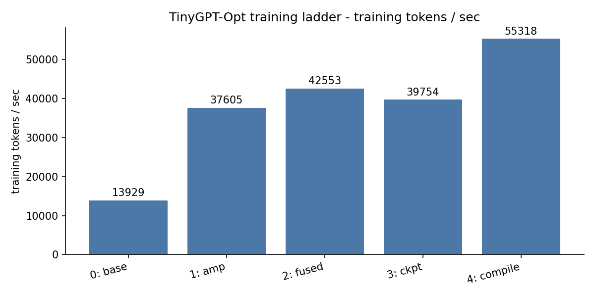
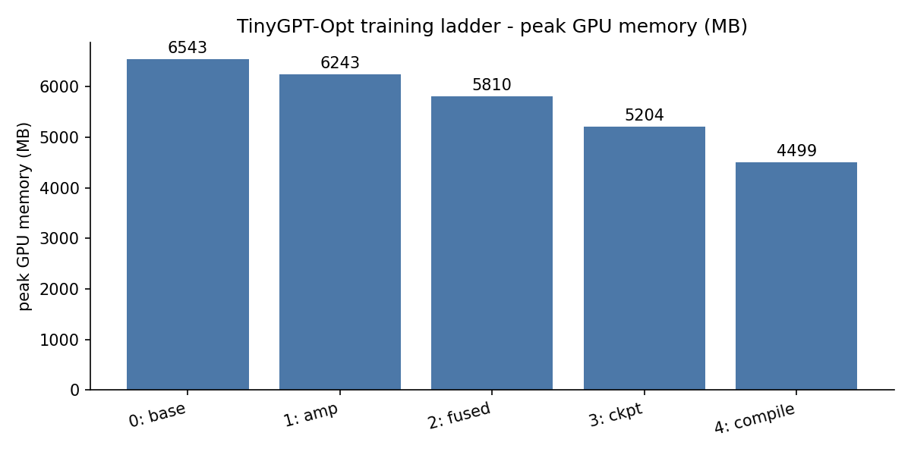
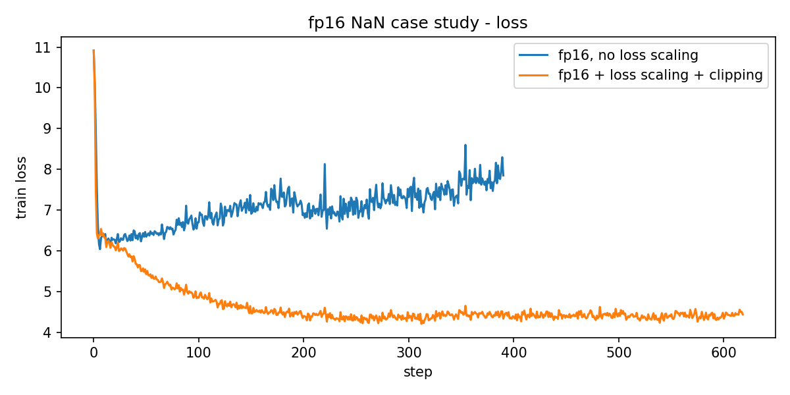
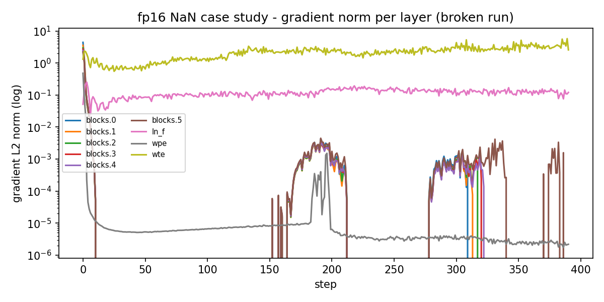

# TinyGPT-Opt: Transformer Training & Inference Optimization in PyTorch

[](https://github.com/KirtiK07/tinygpt-opt/actions/workflows/tests.yml)

A GPT-style transformer written from scratch in PyTorch, then made measurably faster and leaner
one optimization at a time. A test checks each optimization against the unoptimized reference,
so every speedup comes with proof that the outputs didn't change.

Target hardware: Google Colab free tier, NVIDIA T4 (16 GB).

## Headline results (measured on a Colab T4, 2026-11-11)

- **Training: 3.97× tokens/sec** (13,929 → 55,318) and **31% lower peak GPU memory**
  (6,543 → 4,499 MB) from the full training ladder. Validation loss is unchanged (2.0354 → 2.0346).
- **Inference: 15× generation throughput** (241 → 3,633 tokens/sec) with KV-cache + batching.
- **CPU int8: 2.25× faster per token and 2.4× smaller** (114.7 → 47.6 MB).
- **fp16 NaN** reproduced, diagnosed with per-layer gradient norms, and the loss-scaling part fixed.

Every number comes from [`results/results.csv`](results/results.csv), written by the runs in
[`notebooks/colab_run.ipynb`](notebooks/colab_run.ipynb).

## What it covers

| Skill | Where it lives |
|---|---|
| Implement a model | Hand-written transformer in [`tinygpt/model.py`](tinygpt/model.py): embeddings, causal multi-head attention, MLP, LayerNorm, residuals, weight tying |
| Reproducible workflow | YAML configs, fixed seeds, metrics CSV, one-command rerun ([`tinygpt/train.py`](tinygpt/train.py)) |
| Optimize memory / throughput | 8-step optimization ladder with before/after numbers |
| Debug numerical failures | fp16 NaN case study ([below](#numerical-debugging-case-study-fp16-nan)) |
| Verify correctness | pytest suite comparing each optimization to the reference ([`tests/`](tests)) |
| Coding agents | [Workflow section](#how-a-coding-agent-was-used) |

## Model

| | |
|---|---|
| Layers / heads / width | 6 / 6 / 384 |
| Context | 256 tokens |
| Parameters | 30.1M (19.3M of them in the tied token embedding) |
| Tokenizer | GPT-2 BPE via `tiktoken` (vocab padded 50257 → 50304) |
| Data | TinyStories (main), Tiny Shakespeare (smoke test) |

Attention has two interchangeable paths, `manual` (matmul → causal mask → softmax → matmul) and
`fused` (`F.scaled_dot_product_attention`). Both support a KV-cache.

## Repo layout

```
configs/      base.yaml (step 0) → amp → fused → ckpt → compile (step 4); shakespeare; nan_repro / nan_fixed
tinygpt/
  model.py    transformer, manual + fused attention, gradient checkpointing, KV-cache
  data.py     download, tokenize, uint16 binary shards, random-batch loader
  train.py    config-driven training loop, AMP + GradScaler, checkpointing, metrics
  generate.py sampling, KV-cache, batched generation
  quantize.py int8 dynamic quantization for CPU inference
  profile.py  inference benchmarks, results report, charts, NaN case-study plots
tests/        correctness tests, one per optimization
results/      results.csv + charts (written by the runs)
notebooks/    colab_run.ipynb, the whole pipeline on a Colab T4
```

## Setup

**Colab (recommended):** open [`notebooks/colab_run.ipynb`](notebooks/colab_run.ipynb), choose
*Runtime → Change runtime type → T4 GPU*, and run the cells top to bottom.

**Local:**

```bash
git clone https://github.com/KirtiK07/tinygpt-opt.git
cd tinygpt-opt
pip install -r requirements.txt     # Python 3.11, PyTorch 2.x
pytest -q                           # correctness suite, about 20 s on CPU
```

## Usage

```bash
# 1. Data
python -m tinygpt.data --dataset shakespeare                 # ~300K tokens, seconds
python -m tinygpt.data --dataset tinystories                 # full set: 2.2 GB download
python -m tinygpt.data --dataset tinystories --max_train_docs 300000   # faster subset

# 2. Baseline: one command reproduces the run
python -m tinygpt.train --config configs/base.yaml

# 3. Training ladder: each config inherits the previous one
python -m tinygpt.train --config configs/amp.yaml
python -m tinygpt.train --config configs/fused.yaml
python -m tinygpt.train --config configs/ckpt.yaml
python -m tinygpt.train --config configs/compile.yaml

# 4. Inference ladder (KV-cache, batching, int8) from the trained model
python -m tinygpt.profile infer --ckpt out/compile/ckpt.pt

# 5. Results table and charts
python -m tinygpt.profile report
python -m tinygpt.profile plot

# Generate text
python -m tinygpt.generate --ckpt out/compile/ckpt.pt --prompt "Once upon a time" --num_samples 3
python -m tinygpt.generate --ckpt out/compile/ckpt.pt --prompt "A dog" --quantize   # int8 on CPU
```

Any config value can be overridden from the command line: `--set max_steps=500 --set model.n_layer=4`.
Each run writes `out/<run_name>/` (resolved config, `metrics.csv`, `ckpt.pt`, `sample.txt`) and
appends a summary row to `results/results.csv`.

## Optimization ladder

Each step is added on top of the previous one, with the same model, data, seed, batch size and
step count (`tests/test_repro.py::test_ladder_configs_stack` enforces this). Training tokens/sec
leaves out the warm-up steps, which also covers `torch.compile`'s compile time.

Training: TinyStories (300K-story subset), 2,000 steps, batch 32 × 256 tokens, Tesla T4.

| # | Technique | How | tokens/sec | vs step 0 | Peak GPU memory | vs step 0 | Val loss |
|---|---|---|---|---|---|---|---|
| 0 | Baseline: fp32, manual attention | plain loop | 13,929 | 1.00× | 6,543 MB | — | 2.0354 |
| 1 | Mixed precision (fp16 + loss scaling) | `torch.autocast` + `GradScaler` | 37,605 | 2.70× | 6,243 MB | −5% | 2.0344 |
| 2 | Fused attention | `F.scaled_dot_product_attention` | 42,553 | 3.05× | 5,810 MB | −11% | 2.0346 |
| 3 | Gradient checkpointing | `torch.utils.checkpoint` per block | 39,754 | 2.85× | 5,204 MB | −20% | 2.0346 |
| 4 | `torch.compile` | `torch.compile(model)` | **55,318** | **3.97×** | **4,499 MB** | **−31%** | 2.0346 |

Inference: prompt of 32 tokens, 200 new tokens, greedy (GPU); 64 new tokens, 1 thread (CPU).

| # | Technique | Device | How | tokens/sec | ms / token | Peak memory / model size |
|---|---|---|---|---|---|---|
| 5-ref | No cache (reference) | T4 | full recompute each token | 241 | 4.16 | 560 MB |
| 5 | KV-cache, batch 1 | T4 | cache keys/values per layer | 168 (0.70×) | 5.95 | 478 MB |
| 6 | KV-cache + batch 16 | T4 | 16 prompts at once | **3,633 (15.1×)** | 4.40 per step | 607 MB |
| 7-ref | fp32 (reference) | CPU | | 73 | 13.73 | 114.7 MB |
| 7 | int8 dynamic quantization | CPU | `quantize_dynamic` | **164 (2.25×)** | **6.09** | **47.6 MB (−58%)** |

What the numbers show:

- **Mixed precision is the biggest single win (2.7×).** The T4's tensor cores only run fp16.
  Validation loss matched fp32 to 0.001.
- **Gradient checkpointing traded speed for memory, as expected.** −7% tokens/sec against step 2
  for −10% peak memory. `torch.compile` then won the speed back and cut memory further by
  fusing elementwise ops (+39% tokens/sec, −14% memory against step 3).
- **Every training rung reached the same validation loss** (2.0344 to 2.0354), so none of the
  optimizations changed what the model learned.
- **The KV-cache was *slower* at batch size 1** (0.70×), the one result that went against the plan.
  With a 30M model and at most 232 tokens of context, recomputing the full sequence is a single
  small GPU launch per layer, while the cached path adds a `torch.cat` and more, smaller kernel
  launches every step. Batch 1 is launch-overhead bound, so the saved FLOPs don't show. The cache
  still used 15% less memory. Once there's enough work per launch (batch 16), throughput rose 15×
  over the reference. The tests confirm the cached and uncached outputs are token-for-token identical.
- **int8 on CPU** halved the per-token latency and cut the file size by 58%.

`python -m tinygpt.profile report` prints this table from `results/results.csv`.





Notes on the int8 step:

- Because of weight tying, quantizing only `nn.Linear` would give `lm_head` its own int8 copy while
  the fp32 embedding stays, and the "quantized" file ends up *larger*. `quantize.py` quantizes the
  embeddings too. The default model's state dict shrinks from about 115 MB to about 48 MB (measured).
- `torch.ao.quantization` is deprecated in recent PyTorch in favour of `torchao`. It still works
  (tested on 2.15).

## Correctness tests

Every optimization has to pass before its numbers count.

| Test | What it checks | Pass condition |
|---|---|---|
| `test_attention.py` | Fused attention vs manual: forward, gradients, and with a KV-cache offset | `torch.allclose`, atol 1e-5 (fp32) |
| `test_kvcache.py` | Greedy generation with vs without KV-cache, including past the context window; incremental vs full logits | Identical token IDs |
| `test_kvcache.py` | Batched vs one-prompt-at-a-time generation | Identical token IDs |
| `test_amp.py` | Mixed-precision loss vs fp32 loss on the same batch | Within 1e-2 (fp16 on GPU; relative 1e-2 for bf16 on CPU) |
| `test_amp.py` | fp16 + GradScaler training stays finite; non-finite loss guard fires | (GPU-only test skips on CPU) |
| `test_repro.py` | Two runs, same seed and config | Identical loss for the first 50 steps |
| `test_repro.py` | Gradient checkpointing vs none | Losses within 1e-5 |
| `test_repro.py` | Ladder configs differ only in the technique being added | Same model, data, steps, seed |
| `test_shapes.py` | Output shapes, parameter count, causal mask | No token attends to future positions |
| `test_quant.py` | int8 vs fp32 next-token prediction; int8 file size | Top-1 agreement > 95%; under half the size |

Current status on CPU (PyTorch 2.15): **27 passed, 1 skipped** (the skip is the GPU-only fp16
training test). `torch.compile` isn't covered by a unit test because compiling on CPU needs a
C++ toolchain. On the T4, its correctness shows as matching validation loss against step 3:
2.0346 for both.

## Numerical debugging case study: fp16 NaN

1. **Break it.** `configs/nan_repro.yaml`: fp16 autocast with `GradScaler` off, 10× learning rate,
   no warm-up, no clipping.
   ```bash
   python -m tinygpt.train --config configs/nan_repro.yaml   # expected: stops with a non-finite loss
   ```
2. **Detect it.** The loop checks every loss and stops on the first `inf`/`NaN` (writes
   `out/nan_repro/nonfinite.txt`). It logs per-layer gradient norms every step
   (`grad_norms.csv`). To find the first bad operation, rerun with `--set detect_anomaly=true`,
   which wraps training in `torch.autograd.set_detect_anomaly`.
3. **Explain it.** fp16 tops out at 65,504, and its smallest normal value is about 6e-5. Without loss
   scaling, small gradients underflow to zero, and with a high learning rate, activations and
   attention scores grow until something overflows to `inf`. `inf - inf` in softmax then gives `NaN`.
4. **Fix it.** `configs/nan_fixed.yaml`: loss scaling back on, gradient clipping at max norm 1.0.
   softmax and LayerNorm already run in fp32 under autocast (the model uses `F.softmax` and
   `F.layer_norm` so that autocast can do this).
   ```bash
   python -m tinygpt.train --config configs/nan_fixed.yaml
   python -m tinygpt.profile nan_plot     # results/nan_loss.png, results/nan_grad_norms.png
   ```
5. **What actually happened on the T4.**

   **Broken run (no loss scaling).** It stopped with a NaN loss at **step 391**. The per-layer
   gradient norms show the real failure came much earlier. From **step 11**, the gradients of
   all six transformer blocks underflowed to exactly 0 in fp16, and stayed at zero in 295 of the
   next 380 steps. Only the token embedding (which also gets gradient through the tied `lm_head`)
   and the final LayerNorm kept learning. With the network frozen and the high learning rate
   pushing the embeddings around, the loss *rose* from 6.3 to 8.3, and then the forward pass
   overflowed.

   **Fixed run (loss scaling + clipping).** No layer's gradient ever went to zero, and the loss
   fell to about 4.4, compared with 8.3 for the broken run at the same point. The scaler did its
   job: it lowered the scale from 65,536 to 8,192 as it skipped steps whose gradients overflowed.
   That fixed the underflow.

   **What loss scaling didn't fix.** At this learning rate (6e-3, 10× normal, no warm-up), the
   fixed run still produced a NaN *loss* at **step 619**. A NaN loss means the forward pass
   overflowed, and loss scaling only protects gradients. So the remaining cause is the learning
   rate itself. The evidence: the same fp16 + `GradScaler` setup at the normal learning rate
   (ladder step 1) trained all 2,000 steps cleanly, with a validation loss of 2.0344 (fp32 got
   2.0354). The full fix is loss scaling *and* a sane learning rate with warm-up. bf16 would avoid
   the overflow too, but the T4 has no bf16 tensor cores.

   

   

   The block lines drop off the log scale where their gradients are exactly zero.

## Sample output

From the step-4 model after 2,000 steps (about 16M training tokens), prompt "Once upon a time":

> Once upon a time, in a small town, there was a cow named Lily. Lily was a nervous girl who loved
> to play with her friends. One day, Lily saw a big box in the park. She wanted to open the box.
> Lily tried to open the box, but it was hard. She was very curious. She asked her friend, the bird,
> "Can you help me open the box?" Her friend said, "Yes, let's open the box!" Lily and the bird
> opened the box. Inside, they found a big, shiny balloon. Lily was very happy and clapped her hands.

## How a coding agent was used

The first version of this repo was generated with Claude Code from the project plan: the package
layout, model, training loop, benchmarks, configs, tests and this README. Running the test suite
during generation caught two real bugs before the first commit:

- `F.cross_entropy` used `.view()` on non-contiguous targets. It now uses `.reshape()`.
- The first int8 version quantized only `nn.Linear`. With tied embeddings, the result was *larger*
  than fp32. Quantizing the embeddings as well fixed it, and a size test now guards against it.

*TODO (author):* note what you reviewed, rewrote by hand and changed after running on the T4.
The plan says the model code should be written and understood by you, so go through
`tinygpt/model.py` line by line.

## Definition of done

- [x] Model trains from scratch and produces readable sample stories (sample below)
- [x] One command reproduces the baseline run from a config file
- [x] All 8 ladder steps measured and logged in `results.csv`
- [x] All tests in `tests/` pass (CPU, and in CI on every push)
- [x] fp16 NaN case study written up with plots
- [x] README has the results table, two charts, setup steps and a coding-agent workflow section
- [x] Repo is public
- [ ] Pinned on GitHub and linked from the resume
